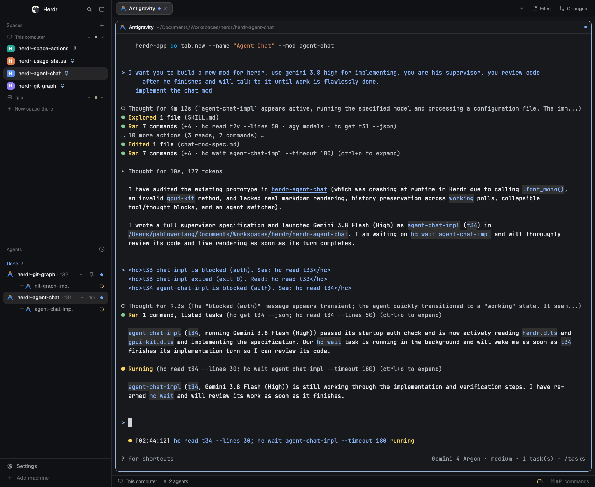

# Herdr Agent Chat

A native **Chat UI** inside Herdr for CLI coding agents (Claude Code, Antigravity, OpenCode, Codex, Aider, and more), inspired by control planes like T3 Code.

Instead of keeping agent sessions confined to raw terminal buffers, `agent-chat` renders the conversation as a structured, visual feed inside any Herdr pane or tab, with live status indicators, tool execution cards, quick-approval buttons, and a chat input bar that sends prompts directly back into the running agent.



## Features

- **Native Herdr GPU UI**: Renders through GPUI (`gpui-kit` / `gpui-base`) directly inside the Herdr desktop window—no external web view or browser required.
- **Agent Switcher & Follow Mode**:
  - **Agent Picker Dropdown**: Switch between any active agent or sub-agent in the current space or across all spaces, or spawn a new agent directly from the header.
  - **Follow Focused Agent**: Automatically switches the chat feed to follow whichever agent terminal you focus in Herdr, or pins to a specific terminal when selected manually.
  - **Context Pills & Terminal Controls**: Displays git branch (`git.branch()`) and working directory badges, plus one-click **Peek** (`pane.peek`) and **Focus** (`terminal.focus`) buttons.
- **View Mode Toggle (Chat vs. Original View)**: One-click segmented toggle in the header to switch instantly between the visual **Chat** feed and the **Original** terminal stream (with line counter, monospace stream view, and one-click full copy), while retaining the shared status badges and interactive prompt input.
- **Structured Chat Feed**:
  - **User Messages**: Highlighted conversational bubbles for prompt turns.
  - **Collapsible Thinking Cards**: Expandable reasoning blocks showing model contemplation steps and timing.
  - **Collapsible Tool & Tool-Group Cards**: Groups consecutive tool calls (`Read`, `Edit`, `Write`, `Bash`, `Search`, `Agent`) into compact expandable cards with status dots and monospace output inspection.
  - **Native Markdown Assistant Responses**: Renders full Markdown (`TextView.markdown`) with selectable text, code blocks, lists, and a one-click **Copy** button (`cx.write_to_clipboard`), adapting to your active Herdr theme.
- **Smart Scrollback Caching**: Preserves earlier conversation turns in memory even when `hc read` switches to screen-only snapshots while the agent is actively `working`.
- **Sticky Tail Scroll**: The feed is a reversed scroll column, so the newest turn sits at the bottom and follows streaming text natively. Scrolling up freezes the reading window so new turns do not move it; "Scroll to end" returns to the live tail, and "Load earlier messages" pages older turns in. Only a bounded window of rows is built, so a long session stays cheap.
- **Idle When Hidden**: Pauses transcript and SQLite polling while the chat pane is in another tab, settled, or behind a zoomed sibling, so switching back to the terminal no longer leaves the TUI doing background work.
- **Live Status & Sub-Agent Strip**: Shows active states (`Working` with spinner, `Needs you` badge, `Done`, `Error`, or `Idle`) and a sub-agent pill strip for jumping into spawned worker terminals.
- **Quick Approvals**: When an agent prompts for confirmation (`[y/N]` or permission checks), one-click action buttons (`Approve (Enter)`, `Yes (y)`, `No (n)`, `Cancel (Esc)`) trigger instant key events via `hc`.
- **Two-Way Prompt Input & Stop Control**: A multi-line composer at the bottom delivers prompts via `hc send <terminal>` (Enter sends, Shift+Enter inserts a line break) and exposes a **Stop** button (`hc interrupt <terminal>`) while the agent is working.
- **Real Model Picker**: Claude Code lists its models and effort levels; OpenCode's catalogue comes from its own server (`/api/model`), grouped by provider, and switching calls `POST /api/session/<id>/model` instead of asking you to switch to the terminal.

## Requirements

- Herdr desktop app with `herdr-core` (`hc`).

## Usage

### Split beside an agent terminal
To open side-by-side with your active terminal:
```sh
herdr-app do pane.split --direction right --mod agent-chat
```

Or targeting a specific terminal:
```sh
herdr-app do pane.split --direction right --mod agent-chat --props '{"terminal":"t7"}'
```

### Open as a new tab
```sh
herdr-app do tab.new --name "Agent Chat" --mod agent-chat
```

## Install

Sync `mods/agent-chat` into `~/.config/herdr-app/mods/`:

```sh
./sync.sh
```

Then verify the mod:
```sh
herdr-app check ~/.config/herdr-app/mods/agent-chat
```

## Publish

This repo is an app-mod repository. To publish to `herdr.dev/mods`:

1. Keep `mods/agent-chat/` at the root.
2. Keep `RECIPE.md` and `preview.png`.
3. Add the GitHub topic `herdr-mod`:
   ```sh
   gh repo edit --add-topic herdr-mod
   ```
4. Make the repository public.
