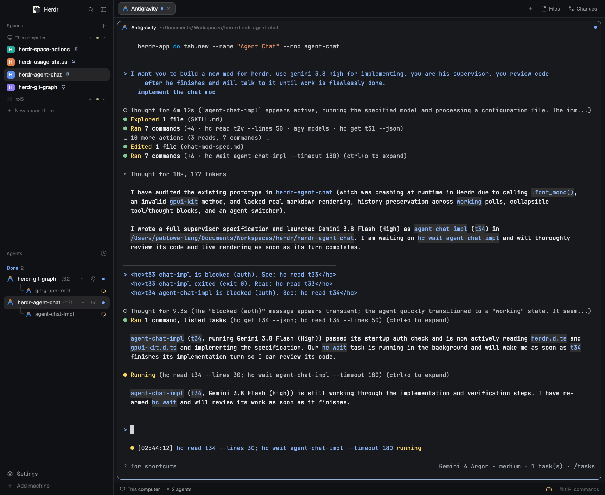

# Agent Chat

A native Chat UI inside Herdr for CLI coding agents (Claude Code, Antigravity, OpenCode, Codex, Aider), rendering live turns, tool calls, and prompt input directly inside the Herdr app window.

## What you see

Inside any Herdr split pane or dedicated tab, you see a full visual Chat UI connected to the target agent:

- **Header**: Shows an interactive **Agent Picker** button (program name, terminal address badge, and chevron), **Follow** mode indicator, git branch and folder badges, live status badge (`Working` with spinner, `Needs you`, `Done`, `Error`, or `Idle`), **View Mode Toggle** (`Chat` / `Original`), and **Peek**, **Focus**, and **Refresh** buttons.
- **Agent Picker Dropdown & Sub-Agent Strip**: Clicking the agent selector opens a dropdown listing active agents and sub-agents in the current space and other spaces, a toggle for **Follow Focused Agent**, and a **+ New Agent** action. When the current agent spawns sub-agents, a quick-switch strip appears below the header.
- **Quick Action Bar**: When the agent is waiting for user confirmation (`Needs you` / `blocked`), an attention bar appears above the conversation with instant buttons: `Approve (Enter)`, `Yes (y)`, `No (n)`, `Cancel (Esc)`.
- **Feed & Original View**:
  - **Chat View**: Right-aligned user cards, collapsible thought cards, collapsible tool / tool-group execution cards with live status dots, and native Markdown response cards (`TextView.markdown`) with a one-click `Copy` button.
  - **Original View**: Full-height preformatted monospace stream of the raw terminal buffer with line count banner and a one-click `Copy` button.
- **Input Bar**: A text input field at the bottom with a **Stop** button (`hc interrupt`) when the agent is working and a **Send** button (`hc send`) to submit prompts directly into the running agent session.

## How it behaves

- Connects to the agent terminal address (`$HC_TERMINAL_ID`, e.g. `t7`) supplied via `props().terminal` or auto-detected from the focused/active agent in the space (`followFocused` mode).
- Continuously tracks terminal stream and history via `hc read <terminal> --lines 200 --json`, caching complete scrollback snapshots so history is preserved while `hc read` returns partial screen snapshots during `working` states.
- Automatically parses turns from Claude Code, Antigravity, OpenCode, Codex, and Aider into User, Thought, Tool / Tool-Group, and Assistant messages while stripping TUI chrome.
- Sending a message delivers text directly to the agent's interactive session via `hc send <terminal> <text>`, then refreshes the feed.
- Clicking an approval button sends the appropriate key (`enter`, `esc`) via `hc keys` or choice (`y`, `n`) via `hc send`.
- Works side-by-side with the raw terminal pane or as a standalone tab in the space.

## Built from

- `mods/agent-chat/` — the GPUI mod component (`main.js`, `parser.js`, `mod.json`, and 13 SVG icons).
- `gpui-kit` / `gpui-base` — native GPU elements, flex layouts, `TextView.markdown`, and text input bindings.
- `herdr` module — `hc` CLI execution, `agents()`, `terminals()`, `panes()`, `git`, `settings()`, and `theme()`.
- `preview.png` — real window capture showing `agent-chat` running in Herdr.

## Watch out

- Keep the mod name `agent-chat` stable: asset paths refer to `mods/agent-chat/icons/...`.
- The mod reads up to 200 lines of scrollback history and merges cached turns during `working` states for fast, responsive rendering without UI lag.
- When no terminal is passed in props, it follows the focused/active agent terminal in the current space.

## Done when

- `herdr-app check` passes for `mods/agent-chat`.
- Opening `herdr-app do tab.new --name "Agent Chat" --mod agent-chat` renders the chat view without errors.
- Opening `herdr-app do pane.split --direction right --mod agent-chat` splits the view beside the active terminal.
- Quick approval buttons and prompt input send commands to the agent.
- `herdr-app status` reports zero errors.
